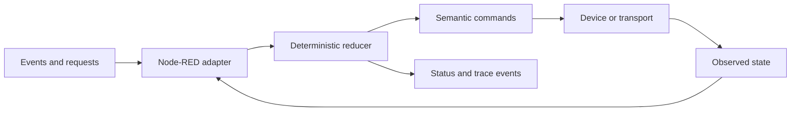

# Node-RED Home Automation

[](https://github.com/cptbucky/node-red-home-automation/actions/workflows/ci.yml)

State-aware Node-RED controllers for reliable lighting and home-theatre automation.

**[View the interactive home-theatre roadmap →](https://cptbucky.github.io/node-red-home-automation/)**

Most home automations translate an event directly into a command. This package adds a deterministic control layer between them: it tracks desired and observed state, preserves manual control, confirms outcomes, retries bounded failures, and rejects stale work.

## What it solves

- **Occupancy without flicker:** combine PIR motion with optional presence sensing before changing room state.
- **Adaptive lighting with manual ownership:** calculate circadian brightness and colour temperature without immediately overwriting wall-switch changes.
- **Reliable AV transitions:** coordinate AVR inputs, TV power, projector warm-up and cooldown, and motorised screens from observed state rather than blind toggles.
- **Honest source readiness:** model controllable, externally controlled, and unavailable playback sources without claiming success from an input selection alone.
- **Recoverable automation:** keep reducers deterministic and persistable so Node-RED restarts can reconcile state safely.



## Included nodes

| Node | Purpose |
|---|---|
| `home-occupancy-fusion` | Combines PIR motion with optional presence sensing. |
| `home-motion-lighting-policy` | Converts occupancy and illuminance into lighting intent. |
| `home-room-lighting-controller` | Owns adaptive room commands, manual overrides, and lighting state. |
| `home-avr-controller` | Controls AVR power, zones, and source selection from observed state. |
| `home-display-mode-controller` | Coordinates TV, projector, and screen transitions. |
| `home-source-capability-controller` | Tracks controllable, external, and unavailable media sources. |

Pure TypeScript policy modules live in `lib/`; thin Node-RED runtime and editor adapters live in `nodes/`.

## Requirements

- Node.js 20 or newer
- Node-RED 4.1.x

## Install

The package is currently distributed from source rather than npm:

```sh
git clone https://github.com/cptbucky/node-red-home-automation.git
cd node-red-home-automation
npm ci
npm test
npm pack
```

Install the resulting tarball through **Node-RED → Manage palette → Install → Upload module**, or from a Node-RED user directory:

```sh
npm install /path/to/avantics-node-red-home-automation-1.6.0.tgz
```

Add the installed nodes from the Node-RED palette, then configure the room, device hosts, MQTT topics, source mappings, and timing limits for your deployment.

## Configuration and security

The repository contains no home-network addresses, deployment coordinates, or live credentials. Device hosts and room coordinates are required configuration where applicable.

The display controller stores its Bravia PSK as a Node-RED credential. Keep credentials in Node-RED's encrypted credential store rather than flow fields or repository files.

## Development

```sh
npm ci
npm test
```

The strict TypeScript build, compiled test suite, dependency audit, public-content scan, and secret scan run in CI. See [CONTRIBUTING.md](CONTRIBUTING.md) for local checks and the optional pre-commit setup.

## License

[MIT](LICENSE)
