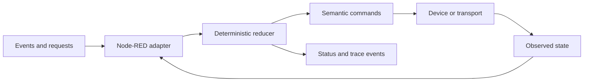

# Node-RED Home Automation

[](https://github.com/cptbucky/node-red-home-automation/actions/workflows/ci.yml)

State-aware Node-RED controllers for reliable lighting and home-theatre automation.

**[View the smart-home programme and completed project records →](https://cptbucky.github.io/node-red-home-automation/)**

Most home automations translate an event directly into a command. This package adds a deterministic control layer between them: it tracks desired and observed state, preserves manual control, confirms outcomes, retries bounded failures, and rejects stale work.

## What it solves

- **Occupancy without flicker:** combine PIR motion with optional presence sensing before changing room state.
- **Adaptive lighting with manual ownership:** calculate circadian brightness and colour temperature without immediately overwriting wall-switch changes.
- **Reliable AV transitions:** coordinate AVR inputs, TV power, projector warm-up and cooldown, and motorised screens from observed state rather than blind toggles.
- **Honest source readiness:** model controllable, externally controlled, and unavailable playback sources without claiming success from an input selection alone.
- **Owned theatre atmosphere:** apply activity lighting only to active, non-manual room lights and confirm TV backlighting independently.
- **Recoverable automation:** adopt one fresh, uniquely matching physical activity after lost state; otherwise coordinate a safe Off request.



## Included nodes

| Node | Purpose |
|---|---|
| `home-occupancy-fusion` | Combines PIR motion with optional presence sensing. |
| `home-motion-lighting-policy` | Converts occupancy and illuminance into lighting intent. |
| `home-switch-lighting-policy` | Converts raw edges or pre-classified button actions into lighting intent without motion state. |
| `home-room-lighting-controller` | Owns adaptive room commands, manual overrides, and lighting state. |
| `home-avr-controller` | Controls AVR power, zones, and source selection from observed state. |
| `home-display-mode-controller` | Coordinates TV, projector, and screen transitions. |
| `home-source-capability-controller` | Tracks controllable, external, and unavailable media sources. |
| `home-activity-lighting-controller` | Applies activity styles without taking room power or manual ownership. |
| `home-backlighting-controller` | Owns TV-backlight power with observation-gated confirmation. |
| `home-theatre-activity-controller` | Owns latest-request-wins activity state and aggregates target evidence. |
| `home-theatre-state-contract` | Bridges non-retained activity requests to retained MQTT truth and HA discovery. |

Pure TypeScript policy modules live in `lib/`; thin Node-RED runtime and editor adapters live in `nodes/`.

## Requirements

- Node.js 20 or newer
- Node-RED 4.1.x

## Install

The package is currently distributed from source rather than npm:

```sh
git clone https://github.com/cptbucky/node-red-home-automation.git
cd node-red-home-automation
npm ci
npm test
npm pack
```

Install the resulting tarball through **Node-RED → Manage palette → Install → Upload module**, or from a Node-RED user directory:

```sh
npm install /path/to/avantics-node-red-home-automation-1.11.0.tgz
```

Add the installed nodes from the Node-RED palette, then configure the room, device hosts, MQTT topics, source mappings, and timing limits for your deployment.

The whole-theatre MQTT contract uses non-retained requests at
`home/<area>/theatre/request`; every request supplies a unique `requestId` and an
explicit configured activity. Controller output is retained under `desired`,
`current`, `phase`, `failure`, `availability`, `metrics`, `slo`, and
`health/<target>`. Metrics expose transition latency and outcome counts plus
per-target retry, fallback, confirmation-latency, failure, manual-override, and
availability evidence. The SLO evaluator keeps a bounded outcome window,
publishes success rate plus p50/p95 transition latency, and exposes an
actionable Home Assistant problem sensor. Defaults are a 60-second transition
budget, 95% success objective, 20 outcomes and five samples before normal
evaluation; active timeouts and explicit failures breach immediately. Expected
`waiting_for_source` and physical manual ownership do not create false
operational failures. Retained request messages are deliberately inert.

Unsolicited display, AVR, source, and backlighting changes latch manual
ownership instead of issuing corrective commands. A newer explicit activity
request resumes automation. Recovery adopts physical state only when fresh
display, AVR, source, and backlighting evidence matches exactly one configured
profile; missing or ambiguous startup evidence invokes the configured Off
activity.

## Configuration and security

The repository contains no home-network addresses, deployment coordinates, or live credentials. Device hosts and room coordinates are required configuration where applicable.

The display controller stores its Bravia PSK as a Node-RED credential. Keep credentials in Node-RED's encrypted credential store rather than flow fields or repository files.

## Public repository boundary

This repository contains reusable controller code and general delivery status.
Live flows, private hostnames and IP addresses, Home Assistant entity IDs,
backup paths, credentials, and infrastructure operations belong only in the
private deployment repositories. `npm run scan:public` enforces the machine-
detectable parts of that boundary.

## Development

```sh
npm ci
npm test
```

The strict TypeScript build, compiled test suite, dependency audit, public-content scan, and secret scan run in CI. See [CONTRIBUTING.md](CONTRIBUTING.md) for local checks and the optional pre-commit setup.

## License

[MIT](LICENSE)
